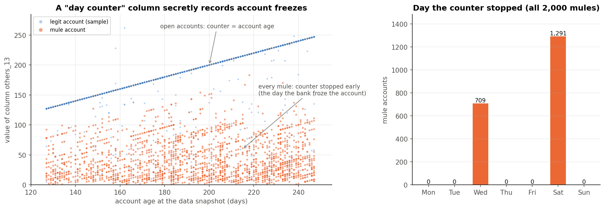
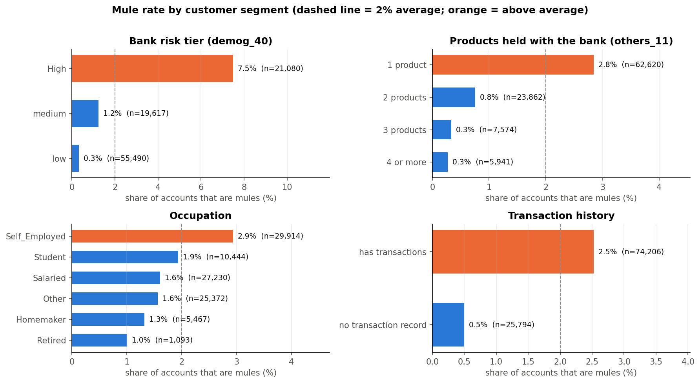
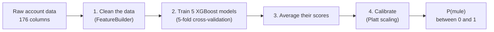
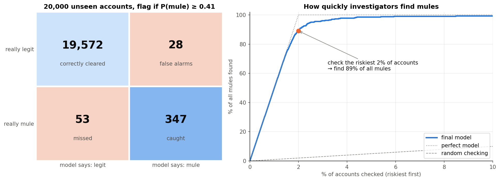
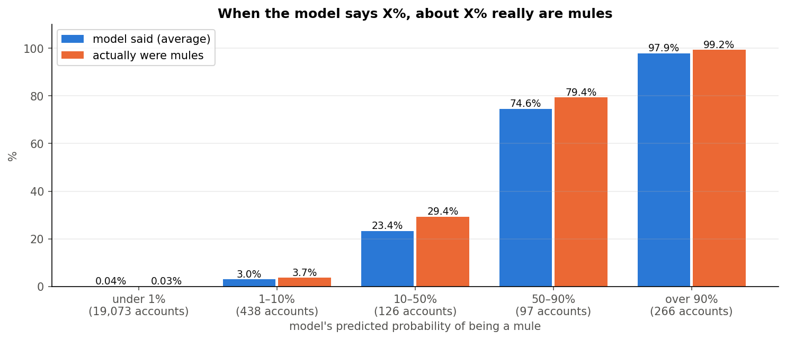
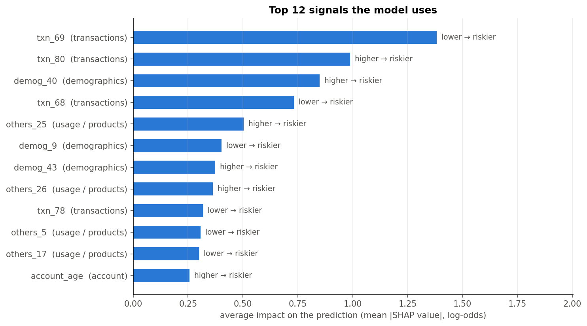

# Money-Mule Detection

A machine-learning model that estimates **how likely a bank account is to be a "money mule"**: an account opened only to
receive money stolen from fraud victims and pass it on.

---

## The problem

A bank lets people open savings accounts completely online. Fraudsters abuse this: they open accounts, trick victims
into sending them money (fake jobs, fake investments, impersonation scams), and quickly move the money out. These
accounts are called **money mules**.

The bank wants to spot mule accounts automatically. For every account, the model gives a **probability between 0 and 1**
that the account is a mule.

- **Data:** 100,000 past accounts where we know the answer, and 50,000 new accounts to score.
- **Challenge:** only **2 in every 100 accounts are mules**, and the 176 data columns are anonymised (most are named
  like `txn_12` or `demog_40`, so we don't know exactly what they measure).

## Results at a glance

Measured on **20,000 accounts the model never saw during training**:

| | Random guessing | Simple first model | **Final model** |
|---|---|---|---|
| Mules caught (of 400) | — | 326 | **347 (87%)** |
| False alarms (of 19,600 legit) | — | 23 | **28** |
| PR-AUC (ranking quality, 1 = perfect) | 0.02 | 0.929 | **0.953** |
| Log-loss (probability error, lower = better) | 0.098 | 0.0164 | **0.0125** |

- **When the model flags an account, it is right 92.5% of the time**, and it finds 87% of all mules.
- **If investigators check only the riskiest 2% of accounts, they find 89% of all mules.**
- **The probabilities can be trusted:** on average the model predicts 1.92% mules; the true rate is 2.00%.

---

## What we learned from the data

### 1. A hidden "leak": some columns secretly recorded the answer

Nine columns looked like perfect predictors. Investigation showed they are **day counters that stop when the bank
freezes an account**. Every mule had been frozen (always on a **Wednesday or Saturday**, i.e. a twice-weekly batch
process), so these columns were recording *the bank's reaction*, not the mule's behaviour.



A real monitoring system has to catch mules **before** they are frozen, when these counters carry no information.
**So all nine columns were removed.** Keeping them would have produced a more impressive score, but a model that is
useless in practice.

### 2. Who the mules are



A typical mule account is **flagged "High" by the bank's own risk tier, holds just one product, belongs to a
self-employed customer, and actively transacts**. Accounts with no transaction history at all are rarely mules (0.5%):
a mule exists to move money.

Other patterns: all 2,000 mules are Indian-registered accounts, mules are younger (median age 25 vs 28), Android users are
riskier than iPhone users (2.6% vs 0.8%), and half of all mules were frozen within 33 days of opening.

---

## How the final model works



1. **Clean the data.** Remove the 9 leaky columns and 12 columns that never change; turn a placeholder value (`9999`)
   into "missing"; convert ordered categories (income bands, low/medium/High risk tiers) into numbers; turn the opening
   date into **account age in days**. Missing values are **left as missing**: an empty transaction history is itself a
   strong clue, and XGBoost handles gaps natively.
2. **Train XGBoost**, a gradient-boosted decision-tree model, the standard choice for table-shaped data like this. The
   data is split into 5 parts; each of 5 models trains on 4 parts and is checked on the 5th.
3. **Average the 5 models.** This gives more stable predictions than any single model.
4. **Calibrate.** A small final step (Platt scaling) adjusts the scores so that "30%" really means a 30% chance.

### Why it is built this way

- **Mules get only slightly more weight than legit accounts (×2.3).** The textbook approach would weight each mule ×49
  (to balance 98% vs 2%), but that made the model memorise individual mules and perform worse. The best weight was
  found by automatic tuning (Optuna).
- **The model settings were tuned automatically.** The most useful setting caps how much any single tree can change a
  prediction, which stops the model from becoming over-confident based on a handful of examples.
- **No extra engineered features.** Several were built and tested (activity totals, ratios, comparison with similar
  customers); none improved results beyond random variation, so the model stays simple.
- **One model type.** CatBoost and a combination of models were tried; neither beat a single tuned XGBoost.

Details of every experiment are in the notebooks (see below).

---

## How well it works

### Catching mules



The bank can choose how strict to be. A lower threshold catches more mules but raises more false alarms:

| Flag accounts with P(mule) above | Accounts flagged (per 10,000) | Flags that are real mules | Mules caught |
|---|---|---|---|
| 0.05 | 277 | 69% | 95.5% |
| 0.10 | 245 | 77% | 94.5% |
| 0.20 | 214 | 86% | 91.5% |
| **0.41 (balanced choice)** | **188** | **92.5%** | **86.8%** |
| 0.80 | 153 | 98% | 75% |
| 0.95 | 118 | 99% | 58.5% |

### Honest probabilities



When the model says an account is 90%+ likely to be a mule, 99% of those accounts are. It is slightly cautious in the
middle range (it says ~23% where ~29% are mules), and very accurate at the low end where most accounts are.

### What the model looks at



The strongest signals are transaction activity, the bank's own risk tiers (`demog_40`, `demog_43`) and login activity
(`others_25`, `others_26`). Measured with SHAP values, which show how much each column moves each prediction.

**Where it still goes wrong:** the mules it misses look dormant (very little activity, probably frozen before they
became active), and the false alarms are unusually active genuine customers.

---

## How we made sure the results are real

- **A locked test set:** 20% of accounts were set aside at the start and never used to train or tune anything.
- **Repeated testing:** every decision was checked with 5-fold cross-validation, repeated with 3 random seeds, and a
  change was only kept if it beat the random variation.
- **Confidence ranges:** resampling the test set 2,000 times gives a 95% range of 0.936–0.967 for PR-AUC. The gain over
  the simple first model is statistically significant.
- **Leak check on every column:** each column was tested for whether it changes when the bank closes an account. The
  removed counters did; none of the kept columns showed that pattern.
- **Same population:** the 50,000 new accounts look statistically identical to the training accounts, so the test
  results should carry over.

## Limitations

- **One snapshot in time.** The model should be re-checked on later months before real use; mule behaviour changes.
- **Accounts are 4–8 months old in this data.** To catch mules in their first days, the training data should be rebuilt
  from what was known at each account's early life.
- **Labels are mules the bank caught.** Some uncaught mules may be hiding among the "legit" accounts.
- **Anonymised columns** limit which business features can be built. The strongest known mule signals, such as how
  fast money leaves after it arrives, need to know which columns are money in vs money out.

---

## Project structure

```
Fraud-Detection/
├── data/            the provided Excel files (a faster .parquet copy is created on first load)
├── src/             the final model
│   ├── data.py          loads the data
│   ├── features.py      cleans it (FeatureBuilder)
│   ├── model.py         training, calibration, the end-to-end FraudModel
│   ├── train.py         trains the final model
│   └── predict.py       scores the 50,000 new accounts
├── experiments/     notebooks with all analysis and experiments
├── docs/images/     charts used in this README
└── artifacts/       saved model and predictions (submission.csv)
```

### How to run

```bash
pip install -r requirements.txt
python -m src.train      # trains the model on all 100,000 accounts (~40 seconds on a GPU)
python -m src.predict    # writes artifacts/submission.csv: Primary key + probability for each account
```

The model runs on an NVIDIA GPU by default. Without one, change `device="cuda"` to `device="cpu"` in `src/model.py`.

### Notebooks

| Notebook | What it covers |
|---|---|
| `01_eda` | exploring the data; finding the leak |
| `02_baseline_xgboost` | first simple model; calibration; removing the leak |
| `03_null_handling_feature_engineering`, `03b_…` | missing values and engineered features |
| `04_model_experiments`, `04b_…` | class weights, SMOTE, tuning, CatBoost, Isolation Forest |
| `05_final_evaluation` | final model on the test set, confidence ranges, thresholds |
| `06_readme_figures` | the charts in this README |
